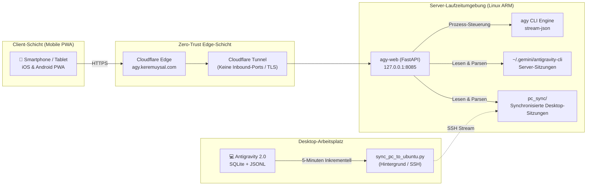

> 🌐 **Sprache / Language / Dil:** [Türkçe](/posts/otonom-kodlama-ajanlari-ve-antigravity-web-mimarisi/) | [English](/posts/autonomous-coding-agents-and-antigravity-web-architecture-en/) | **Deutsch**
{: .prompt-info }

> ℹ️ Der vollständige Open-Source-Code des in diesem Artikel beschriebenen Projekts ist auf **[GitHub: keremuysal/antigravity-web](https://github.com/keremuysal/antigravity-web)** verfügbar.
{: .prompt-info }

## Einleitung: Der Paradigmenwechsel vom Chatbot zu autonomen Agentenschleifen

Als große Sprachmodelle (LLMs) erstmals breite Aufmerksamkeit erlangten, war das zugrundeliegende Interaktionsmodell im Wesentlichen **zustandslos (stateless)**. Modelle verhielten sich wie Konversations-Orakel: Sie lieferten isolierte Antworten auf Prompt-Eingaben, besaßen jedoch keinerlei Einblick in reale Projektdateien und waren nicht in der Lage, ihren eigenen Code zu kompilieren, auszuführen oder automatisiert zu testen.

In den letzten zwei Jahren erlebte die Softwaretechnik einen tiefgreifenden Paradigmenwechsel: den Übergang von flüchtigen Chatfenstern zu **autonomen Agentenschleifen (Agentic Loops)**. Heute fragen wir eine KI nur noch selten: *„Wie implementiere ich diesen Algorithmus?“* Stattdessen übertragen wir ihr ein komplexes Software-Ziel. Der Agent:
1. Analysiert die Codebasis, Systemabhängigkeiten und Architekturmuster,
2. Formuliert einen mehrphasigen Implementierungsplan,
3. Modifiziert Code über mehrere Dateien hinweg,
4. Führt Terminal-Befehle und automatisierte Testsuiten aus,
5. Behebt Compiler-Fehler oder Laufzeit-Exceptions eigenständig (Self-Healing),
6. Und fasst das Ergebnis in strukturierten Code-Diffs zusammen.

Googles **Antigravity** (und dessen Linux-CLI-Binary `agy`) markiert die Speerspitze dieses modernen Workflows. Doch inmitten dieser enormen Effizienzsteigerung entstand ein gravierender physischer Engpass: **Der Agent war an den Desktop gefesselt.**

---

## Das Problem: Das Desktop-Silo und die Terminal-Barriere

Software-Ingenieure verbringen ihren Tag nicht ausschließlich vor dem Desktop-Monitor. Architektonische Einfälle entstehen oft unterwegs, in einer Kaffeepause oder beim Pendeln; ebenso besteht häufig der Wunsch, den Fortschritt eines zuvor gestarteten umfangreichen Refactorings oder Testdurchlaufs von unterwegs zu überwachen.

Google Antigravity operierte bisher in zwei getrennten Welten:
* **Windows / macOS:** Die Antigravity 2.0 Desktop-IDE.
* **Linux-Server:** Das headless `agy` CLI-Binary.

Ein Zugriff auf diese Workflows vom Smartphone oder Tablet aus war praktisch ausgeschlossen. Der Einsatz klassischer mobiler SSH-Clients erwies sich als sperrig und scheiterte an der Darstellung reichhaltiger multimodaler Ausgaben – wie Mermaid-Architekturdiagrammen, interaktiven Entscheidungskarten (`ask_question`), iterierbaren Implementierungsplänen und farblich hervorgehobenen Zeilen-Diffs.

Die Anforderung war eindeutig: **Entwicklung einer leichtgewichtigen, selbst gehosteten Progressive Web App (PWA), die Desktop- und Server-Zustände bidirektional synchronisiert, Token- und Gedankengänge in Echtzeit streamt und ohne jegliche offene Inbound-Ports im Internet betrieben werden kann.**

---

## 1. Reverse Engineering: Den Geist des Desktop-Agenten entschlüsseln

Um einen externen Web-Client zu bauen, der die Fähigkeiten von Antigravity nahtlos abbildet, musste zunächst analysiert werden, wie die Desktop-Laufzeitumgebung ihre Zustände auf der Festplatte speichert (`%USERPROFILE%\.gemini\antigravity`).

Die Dateisystemanalyse ergab drei zentrale persistente Datenschichten:

```
~/.gemini/antigravity/
├── conversation_summaries.db     # SQLite: Metadaten, Sitzungsübersichten, Zeitstempel
├── annotations/
│   └── <conversation_id>.pbtxt  # Protocol Buffer: Thread-Titel & Kontext-Tags
└── brain/
    └── <conversation_id>/
        ├── .system_generated/
        │   └── logs/
        │       ├── transcript.jsonl      # Kompakte ereignisgesteuerte Aktionsschritte
        │       └── transcript_full.jsonl # Vollständige Rohdaten
        └── scratch/                      # Temporäre Arbeitsdateien
```

### A. Nicht-invasive hybride Synchronisation
Die Desktop-Anwendung verwaltet aktive Sitzungen in einer lokalen SQLite-Datenbank. Das direkte Schreiben oder Sperren dieser Datei während des Betriebs der Desktop-App birgt das Risiko von Datenkorruption oder Abstürzen.

Um dies zu verhindern, wurde ein inkrementeller Synchronisationsdienst (`sync_pc_to_ubuntu.py`) entwickelt:
* Er verbindet sich mit der SQLite-Datenbank ausschließlich im **schreibgeschützten URI-Modus** (`file:...db?mode=ro`).
* Er identifiziert veränderte oder neue Sitzungen über eine kompakte Zustandsdatei (`.sync_state.json`).
* Er packt aktualisierte Transkripte und Artefakte in einen speicherbasierten `tar.gz`-Stream, der über authentifiziertes SSH an das Verzeichnis `pc_sync/` des Linux-Servers übertragen wird.
* Er wird als Windows-Aufgabenplanung (`schtasks`) vollautomatisch alle 5 Minuten im Hintergrund ausgeführt.

### B. Ereignisgesteuertes Transkript-Parsing (NDJSON)
Jeder Interaktionsschritt in Antigravity wird als strukturiertes JSON-Ereignis protokolliert. Werkzeugaufrufe (`edit_file`, `run_command`), mehrstufige Ausführungen und interaktive Abfragen bilden diskrete Einzelschritte ab.

Das FastAPI-Backend parst diese Protokolle zur Laufzeit und führt sowohl native Server-Sitzungen (`~/.gemini/antigravity-cli`) als auch synchronisierte Desktop-Sitzungen (`pc_sync/`) in einem vereinheitlichten API-Schema zusammen.

---

## 2. Architektur: Keine offenen Ports und Echtzeit-Streaming

Die Autorisierung eines autonomen Coding-Agenten zur Ausführung beliebiger Shell-Befehle und Dateimanipulationen auf einem Server erfordert kompromisslose Sicherheitsmechanismen und minimale Latenzzeiten.



### A. Zero-Trust-Ingress via Cloudflare Tunnel
Da der Agent über administrative Befehls- und Dateisystemrechte verfügt, verbietet sich das Öffnen regulärer öffentlicher Ports im Internet von selbst.

Die Architektur setzt auf strikte Sicherheitsbarrieren:
1. Der FastAPI-Dienst lauscht ausschließlich auf der lokalen Schnittstelle `127.0.0.1:8085`.
2. Die Verbindung nach außen wird über einen verschlüsselten ausgehenden **Cloudflare Tunnel (`cloudflared`)** hergestellt. Es existieren keinerlei offene eingehende Ports.
3. Die Authentifizierung erfolgt über HMAC-SHA256-signierte Sitzungs-Tokens mit Brute-Force-Schutz (5 Fehlversuche sperren die IP für 15 Minuten).
4. Generierte HTML- und JS-Artefakte des Agenten werden unter einem isolierten `Content-Security-Policy: sandbox`-Header ausgeliefert, um Sitzungsübernahmen auszuschließen.

### B. Live-Streaming von Tokens und Gedankengängen
Um das flüssige Desktop-Gefühl auf mobilen Geräten zu erreichen, bindet sich das Backend direkt an die `--output-format stream-json`-Schnittstelle von `agy`. Der CLI-Prozess gibt Newline-Delimited JSON (NDJSON) direkt in den asynchronen Streaming-Kanal von FastAPI aus.

Auf dem Smartphone wird unmittelbar sichtbar:
* Die internen Denkprozesse des Modells (*Thinking Tokens*),
* Laufende Tool-Parameter und Konsolenausgaben,
* Text- und Code-Generierung mit minimaler Verzögerung.

Zudem ermöglicht eine **⏹️ Abbrechen (Abort)**-Schaltfläche das sofortige Beenden des serverseitigen Prozessbaums via `SIGTERM`.

---

## 3. Desktop Parity: Volle Entwicklungsumgebung auf dem Smartphone

Ein mobiles Interface für Coding-Agenten darf sich nicht auf ein einfaches Chatfenster beschränken; es muss das vollständige Instrumentarium einer IDE bereitstellen:

1. **Battle Mode (⚔️):** Senden Sie einen komplexen Architektur-Prompt parallel an zwei unterschiedliche Modelle, um deren Gedankengänge und Code-Vorschläge direkt miteinander zu vergleichen.
2. **5-teiliges Hilfs-Panel (Auxiliary Workspace):**
   * **📄 Artifacts:** Native Darstellung von Mermaid-Architekturdiagrammen, KaTeX-Formeln und Code-Blöcken, inklusive Rückkanal für Zeilenkommentare an den Agenten.
   * **📝 Diffs:** Zeilenweise Gegenüberstellung von Code-Änderungen (Git-Diff) in Rot und Grün.
   * **🤖 Subagents:** Visuelle Baumstruktur aller vom Hauptagenten zur Recherche gestarteten Sub-Agenten.
   * **🖥️ Mini-Terminal:** Echtzeit-Logüberwachung und sichere Befehlsausführung.
   * **🧩 Widgets:** Interaktive, vom Agenten eingebettete UI-Komponenten (`<agent-embed>`).
3. **Slash-Befehle & Kontext-Verlinkung:** Der mobile Editor unterstützt Autovervollständigung für `/plan`, `/boost`, `/goal` sowie `@`-Erwähnungen von Projektdateien und historischen Konversationen.

---

## 4. Software-Minimalismus: Die Zero-Build Vanilla PWA

In der modernen Webentwicklung führen bereits einfache Projekte oft zu Hunderten Megabyte an `node_modules` und komplexen Build-Pipelines.

Antigravity Web setzt bewusst auf radikalen Software-Minimalismus:
* **Frontend:** Eine einzige, in sich geschlossene `index.html`-Datei mit nativem ES6+, modernen CSS-Variablen und standardisierten Web Components – **vollständig ohne Build-Schritt oder npm-Abhängigkeiten**.
* **Backend:** Eine schlanke FastAPI-Anwendung auf Basis der Python-Standardbibliothek und `uvicorn`.
* **Mobile Erfahrung:** Vollwertig installierbar über standardisierte Web App Manifest- und Service Worker-APIs, wodurch unter iOS und Android ein nativer Vollbildmodus ohne Browserleisten entsteht.

---

## Fazit: Den autonomen Agenten immer dabei haben

Software-Engineering wandelt sich rasant vom manuellen Tippen von Quellcode zur Orchestrierung autonomer Intelligenzen. Durch die Schließung der Kluft zwischen Desktop und Mobilgerät können Entwickler langwierige Refactorings von überall aus begleiten, architektonische Zwischenfragen (`ask_question`) beantworten und komplexe Workflows mobil steuern.

Antigravity Web ist vollständig quelloffen unter der **MIT-Lizenz** lizenziert. Sie können das System auf Ihrem Home-Server, einem Raspberry Pi oder einer Cloud-VM in wenigen Minuten in Betrieb nehmen.

> 🔗 **Projekt auf GitHub entdecken:** [github.com/keremuysal/antigravity-web](https://github.com/keremuysal/antigravity-web)
{: .prompt-tip }
