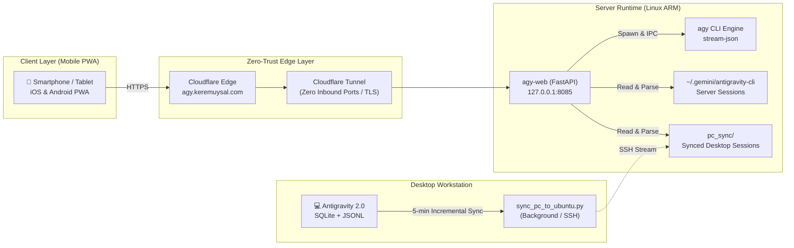

> 🌐 **Language / Dil / Sprache:** [Türkçe](/posts/otonom-kodlama-ajanlari-ve-antigravity-web-mimarisi/) | **English** | [Deutsch](/posts/autonome-coding-agenten-und-antigravity-web-architektur-de/)
{: .prompt-info }

> ℹ️ The complete open-source codebase discussed in this article is available on **[GitHub: keremuysal/antigravity-web](https://github.com/keremuysal/antigravity-web)**.
{: .prompt-info }

## Introduction: The Paradigm Shift from Chatbots to Autonomous Agentic Loops

When Large Language Models (LLMs) first captured the world's attention, our interaction model was fundamentally **stateless**. Models functioned like conversational oracles: they produced coherent, isolated responses to prompt inputs, but possessed no awareness of external reality, could not inspect local project files, and could not compile, execute, or debug their own code.

Over the past two years, software engineering has witnessed a profound paradigm shift: moving away from ephemeral chat windows toward **autonomous agentic loops**. Today, we rarely ask an AI agent, *"How do I write this algorithm?"* Instead, we assign it a complex software objective. The agent:
1. Inspects the codebase, dependencies, and architectural boundaries,
2. Formulates a multi-phase implementation plan,
3. Modifies code across multiple files,
4. Executes terminal commands and automated test suites,
5. Self-heals when encountering compilation errors or runtime stack traces,
6. And finally reports the resolved outcome with structured diffs.

Google's **Antigravity** (and its Linux CLI binary, `agy`) exemplifies this modern agentic workflow. Yet amidst this immense leverage, a glaring physical bottleneck emerged: **the agent was imprisoned on the desktop.**

---

## The Problem: The Desktop Silo and the Terminal Barrier

Software engineers do not spend every waking moment anchored to their desks. An architectural realization often strikes while walking, commuting, or stepping away for coffee; or an engineer may simply want to check the progress of an extensive refactoring or test cycle initiated earlier.

Historically, Google Antigravity operated across two isolated environments:
* **Windows / macOS:** The Antigravity 2.0 desktop IDE application.
* **Linux Server:** The headless `agy` CLI binary.

Accessing these workflows from a smartphone or tablet was virtually impossible. Connecting via standard mobile SSH clients was cumbersome and failed to render the rich multimodal output generated by modern agents—such as Mermaid architecture diagrams, interactive decision cards (`ask_question`), reviewable implementation plans, and line-by-line syntax-highlighted code diffs.

The requirement was clear: **Design an ultra-lightweight, self-hosted Progressive Web App (PWA) that bidirectionally synchronizes desktop and server state, streams raw tokens and internal reasoning in real time, and exposes zero open inbound ports to the internet.**

---

## 1. Reverse-Engineering: Decoupling the Desktop Agent's Mind

To build an external client that mirrors Antigravity's capabilities, we first had to deconstruct how the desktop runtime stores state and context on disk (`%USERPROFILE%\.gemini\antigravity`).

Our file-system analysis revealed three distinct persistent data tiers:

```
~/.gemini/antigravity/
├── conversation_summaries.db     # SQLite: Session metadata, summaries, timestamps
├── annotations/
│   └── <conversation_id>.pbtxt  # Protocol Buffer: Thread titles & contextual tags
└── brain/
    └── <conversation_id>/
        ├── .system_generated/
        │   └── logs/
        │       ├── transcript.jsonl      # Compact event-driven action steps
        │       └── transcript_full.jsonl # Complete uncompressed payloads
        └── scratch/                      # Ephemeral workspace files
```

### A. Non-Intrusive Hybrid Synchronization
The desktop client maintains an index of active sessions in a local SQLite database. Modifying or locking this file while the desktop application is running risks database corruption or application crashes.

To circumvent this, we designed an incremental synchronization daemon (`sync_pc_to_ubuntu.py`) that:
* Connects to SQLite strictly in **read-only URI mode** (`file:...db?mode=ro`).
* Scans for newly created or modified conversation directories using a lightweight JSON state file (`.sync_state.json`).
* Bundles updated artifacts and transcripts into an in-memory `tar.gz` stream sent over authenticated SSH to the remote Linux server (`pc_sync/`).
* Runs as a headless Windows Scheduled Task (`schtasks`) every 5 minutes with zero user friction.

### B. Event-Driven Transcript Parsing (NDJSON)
Every interaction turn in Antigravity is recorded as a structured JSON event. Tool executions (`edit_file`, `run_command`), multi-turn completions, and interactive cards are recorded as discrete steps.

The FastAPI backend parses these logs on the fly, unifying both local server sessions (`~/.gemini/antigravity-cli`) and synchronized desktop sessions (`pc_sync/`) into a standardized API schema.

---

## 2. Architecture: Zero Open Ports and Live Token Streaming

Allowing an autonomous coding agent to execute arbitrary shell commands and file operations on your server requires uncompromising security and sub-millisecond streaming latency.



### A. Zero-Trust Ingress (Cloudflare Tunnel)
Because the agent possesses administrative and filesystem execution capabilities, exposing standard HTTP ports to the open internet is out of the question.

The system enforces strict zero-trust boundaries:
1. The FastAPI service binds exclusively to loopback interface `127.0.0.1:8085`.
2. Traffic is routed via an encrypted outbound **Cloudflare Tunnel (`cloudflared`)**, completely eliminating inbound open ports.
3. Authentication utilizes HMAC-SHA256 session signatures coupled with a strict rate-limiting engine (5 invalid attempts trigger a 15-minute IP quarantine).
4. Arbitrary HTML/JS artifacts generated by the agent are served under an isolated `Content-Security-Policy: sandbox` boundary to prevent cross-site session leakage.

### B. Real-Time Token & Reasoning Streaming
To replicate the desktop experience, the server hooks directly into `agy`'s `--output-format stream-json` pipeline. The process outputs newline-delimited JSON (NDJSON) events directly into FastAPI’s asynchronous streaming response.

Clients observe:
* Live internal reasoning traces (*thinking tokens*),
* Immediate tool invocation arguments and execution logs,
* Real-time text generation with near-zero latency.

Furthermore, a client-side **⏹️ Abort** control sends an instant signal terminating the server-side process tree via `SIGTERM`, ensuring total control over generation costs and rogue operations.

---

## 3. Desktop Parity: True Engineering Capabilities on Mobile

A mobile interface for coding agents cannot be a simple textbox; it must preserve full IDE instrumentation:

1. **Battle Mode (⚔️):** Send a single architectural question or refactoring prompt to two distinct LLMs simultaneously, comparing their reasoning trajectories and code quality side by side.
2. **5-Tab Auxiliary Workspace:**
   * **📄 Artifacts:** Native client rendering of Mermaid architecture diagrams, KaTeX formulas, and markdown deliverables, complete with inline feedback comments sent back to the agent.
   * **📝 Diffs:** Line-by-line red/green git diffs for every modified file.
   * **🤖 Subagents:** Hierarchical tree visualizer tracking subagents spawned by the parent model during multi-task workflows.
   * **🖥️ Mini Terminal:** Real-time log inspection and optional command execution.
   * **🧩 Widgets:** Dynamic HTML UI components embedded by the agent (`<agent-embed>`).
3. **Slash Commands & Context Mentions:** Mobile composer auto-completes `/plan`, `/boost`, and `/goal` triggers, as well as `@` mentions for indexing server project files and historical conversation context.

---

## 4. Software Minimalism: The Zero-Build Vanilla PWA

Modern web engineering often defaults to heavy component frameworks, resulting in hundreds of megabytes of dependencies and complex client hydration cycles.

Antigravity Web embraces radical software minimalism:
* **Frontend:** A single, self-contained `index.html` file leveraging native ES6+, modern CSS custom properties, and standards-compliant Web Components—requiring **zero build steps or node tooling**.
* **Backend:** A lean FastAPI implementation running on Python standard library and `uvicorn`.
* **Mobile Experience:** Fully installable via standard Web App Manifest and Service Worker APIs, yielding a seamless, full-screen native application experience on iOS and Android.

---

## Conclusion: Carrying Your Autonomous Agent in Your Pocket

Software engineering is evolving from manual code typing into orchestrating autonomous intelligence. By bridging the desktop-to-mobile divide, developers can now maintain continuous oversight over long-running refactoring workflows, approve architectural checkpoints, and steer complex agents from anywhere.

Antigravity Web is open source and available under the permissive **MIT License**. You can deploy it to your home lab, a Raspberry Pi, or a free cloud VM in less than five minutes.

> 🔗 **Explore the project on GitHub:** [github.com/keremuysal/antigravity-web](https://github.com/keremuysal/antigravity-web)
{: .prompt-tip }
