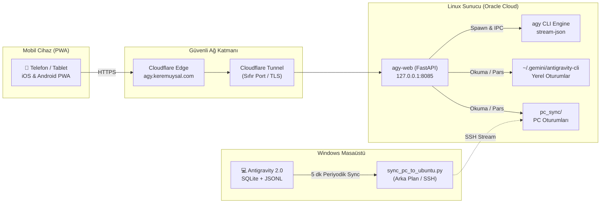

> 🌐 **Dil / Language / Sprache:** **Türkçe** | [English](/posts/autonomous-coding-agents-and-antigravity-web-architecture-en/) | [Deutsch](/posts/autonome-coding-agenten-und-antigravity-web-architektur-de/)
{: .prompt-info }

> ℹ️ Bu makalede incelenen ve açık kaynak olarak yayınlanan projenin kaynak kodlarına **[GitHub: keremuysal/antigravity-web](https://github.com/keremuysal/antigravity-web)** üzerinden ulaşabilirsiniz.
{: .prompt-info }

## Giriş: Sohbet Botlarından Otonom Ajan Döngülerine

Büyük Dil Modelleri (LLM) ilk ortaya çıktığında, etkileşim modelimiz temelde **durumsuz (stateless)** bir soru-cevap mekanizmasından ibaretti. Modeller birer "oracle" (kâhin) gibi davranıyor; sorduğumuz sorulara tek seferlik metin bloklarıyla yanıt veriyor, ancak dünyayla etkileşime geçemiyor, bir dosyayı düzenleyemiyor ya da yazdıkları kodu derleyip test edemiyorlardı.

Son iki yıl içinde yazılım mühendisliğinde yaşanan en köklü paradigma değişimi, bu durumsuz sohbet pencerelerinden **otonom ajan döngülerine (agentic loops)** geçiş oldu. Artık bir yapay zekaya yalnızca *"Bunu nasıl kodlarım?"* demiyoruz; ona bir görev tanımı veriyoruz. Ajan;
1. Çalışma dizinindeki dosyaları okuyor,
2. Soyutlama katmanlarını ve mimariyi analiz ediyor,
3. Bir uygulama planı çıkarıyor,
4. Terminalde komutlar çalıştırıp testleri koşturuyor,
5. Hata aldığında kendi kodunu dinamik olarak düzeltiyor (self-healing),
6. Ve nihayetinde görevi tamamlayıp sonucu raporluyor.

Google’ın geliştirdiği **Antigravity** (ve onun Linux uç noktası olan `agy` CLI), bu ajan paradigmasının en gelişmiş örneklerinden biri. Ancak bu olağanüstü gücün ortasında çok somut bir fiziksel darboğazla karşı karşıyaydık: **Ajan masaüstüne hapsedilmişti.**

---

## Problem: Masaüstünün Duvarları ve Terminal Silosu

Bir yazılım mühendisi olarak gününüzün tamamını masa başında, IDE karşısında geçirmezsiniz. Yolda yürürken, bir toplantı arasındayken ya da bir kafede otururken aklınıza kritik bir mimari fikir gelebilir; veya arka planda başlattığınız uzun soluklu bir derleme, refactoring ya da test sürecinin durumunu merak edebilirsiniz.

Mevcut durumda Google Antigravity iki farklı dünyada yaşıyordu:
* **Windows/macOS:** Antigravity 2.0 masaüstü IDE arayüzü.
* **Linux Sunucu:** Terminal üzerinden çalışan `agy` CLI.

Ancak telefonunuzdan veya tabletinizden bu süreçlere erişmenin, geçmiş konuşmaları incelemenin ya da yeni bir ajan görevi tetiklemenin hiçbir resmi yolu yoktu. Standart bir mobil SSH istemcisiyle terminale bağlanmak ise, ajanın ürettiği zengin görsel çıktıları (Mermaid mimari diyagramları, interaktif onay butonları, satır bazlı kod farkları - diffs) tüketmeyi imkansız hale getiriyordu.

İhtiyaç çok netti: **Masaüstündeki tüm geçmişi sunucuyla hibrit olarak eşitleyen, canlı token ve düşünce akışını mobilde pürüzsüzce sunan, sıfır açık portla güvenli bir mobil PWA istemcisi inşa etmek.**

---

## 1. Tersine Mühendislik: Masaüstü Ajanının Zihnini Okumak

Bir sistemin mobil istemcisini inşa etmek için öncelikle onun yerel diskte nasıl düşündüğünü ve durumunu (state) nasıl sakladığını anlamak gerekiyordu. Antigravity 2.0'ın Windows altındaki veri dizinini (`%USERPROFILE%\.gemini\antigravity`) incelediğimizde üç temel veri katmanı tespit ettik:

```
~/.gemini/antigravity/
├── conversation_summaries.db     # SQLite: Konuşma metaverileri, özetler, zaman damgaları
├── annotations/
│   └── <conversation_id>.pbtxt  # Protocol Buffer: Konuşma başlığı ve bağlam etiketleri
└── brain/
    └── <conversation_id>/
        ├── .system_generated/
        │   └── logs/
        │       ├── transcript.jsonl      # Kompakt JSONL işlem logları
        │       └── transcript_full.jsonl # Truncated alanları içeren tam transkript
        └── scratch/                      # Geçici çalışma dosyaları
```

### A. Veritabanı ve Çift Yönlü Eşitleme
Masaüstü uygulaması, geçmiş oturumların listesini ve son durumlarını bir SQLite veritabanında tutuyordu. Ancak masaüstü açıkken bu dosyaya müdahale etmek kilitlenme (lock) riskleri barındırıyordu. Bu nedenle geliştirilen `sync_pc_to_ubuntu.py` senkronizasyon motoru:
* Veritabanını **salt-okunur (read-only)** modda açar (`file:...db?mode=ro`).
* Yalnızca son senkronizasyondan bu yana değişen veya yeni açılan konuşma dizinlerini tarar (`.sync_state.json`).
* Değişen dosyaları tek bir `tar.gz` akışı halinde SSH üzerinden Linux sunucusundaki `pc_sync/` dizinine incremental olarak basar.
* Windows Görev Zamanlayıcısı (`schtasks`) üzerinden her 5 dakikada bir arka planda sessizce tetiklenir.

### B. Transkript Ayrıştırma (JSON Lines Parser)
Her bir adım (`step`), JSONL formatında bir olay (event) nesnesidir. Modelin bir dosyayı düzenlemesi (`edit_file`), terminal komutu koşturması (`run_command`) ya da kullanıcıya soru sorması (`ask_question`), transkript içinde açıkça etiketlenmiştir.

Sunucu tarafında kurulan FastAPI mimarisi, hem sunucunun kendi yerel `agy` oturumlarını hem de PC'den gelen `pc_sync` oturumlarını anlık olarak ayrıştırıp ortak bir REST API şemasına dönüştürür.

---

## 2. Mimari: Sıfır Açık Port ve Gerçek Zamanlı Akış

Bir mobil istemcinin sunucudaki otonom ajanı kontrol edebilmesi için iki kritik teknik engelin aşılması gerekiyordu: **Ağ Güvenliği** ve **Gerçek Zamanlı İletişim (Streaming)**.



### A. Sıfır Port Mimarisi (Cloudflare Tunnel)
Ajan, sunucu üzerinde dosya yazma ve bash komutları çalıştırma yetkisine sahiptir. Böyle bir uygulamayı doğrudan internete (örneğin public bir porta) açmak kabul edilemez bir güvenlik açığıdır.

Bu nedenle sistem:
1. Yalnızca `127.0.0.1:8085` yerel soketini dinler.
2. Dış dünya ile bağlantı, giden (outbound) bir **Cloudflare Tunnel (`cloudflared`)** üzerinden kurulur. Sunucu üzerinde hiçbir gelen (inbound) port açılmaz.
3. Giriş katmanında brute-force saldırılarına karşı 5 hatalı denemede 15 dakika IP kilitlemesi yapan **PIN tabanlı HMAC oturum mekanizması** çalışır.
4. Model tarafından üretilen rastgele HTML/JS çıktıları (`artifacts`), ana oturum çerezlerine erişemesin diye `Content-Security-Policy: sandbox` başlığı altında yalıtılır.

### B. Token ve Düşünce Akışı (`stream-json`)
Masaüstündeki akıcılığı mobilde yakalamak için `agy` CLI'ının `--output-format stream-json` kabiliyeti kullanıldı. Ajan düşünürken (`thinking`) veya yanıt üretirken NDJSON akışı FastAPI üzerinden istemciye iletilir. İstemci tarafında tek bir satır dahi gecikmeden:
* Modelin iç muhakemesi (akıl yürütme adımları),
* Çalıştırılan araçların parametreleri ve çıktıları,
* Yanıt metni canlı olarak ekrana basılır.

Üstelik kullanıcı dilediği an arayüzdeki **⏹️ Durdur (Abort)** butonuna basarak sunucudaki arka plan `agy` işlem ağacını (process tree) anında `SIGTERM` ile sonlandırabilir.

---

## 3. Desktop Parity: Masaüstünün Tüm Gücü Cebinizde

Basit bir sohbet arayüzü yapmak kolaydır; ancak gerçek bir "kodlama ajanını" mobilde verimli kullanabilmek için masaüstü IDE'sinde alışık olduğumuz tüm araçların eksiksiz sunulması gerekiyordu.

Antigravity Web'de hayata geçirdiğimiz kritik bileşenler:

1. **Çoklu Model ve Battle Mode (⚔️):**
   Karmaşık bir mimari kararda tek bir modele güvenmek yerine, Battle Mode tek bir prompt'u iki farklı modele paralel olarak gönderir. Her iki modelin düşünce zincirini ve kod önerilerini yan yana karşılaştırabilirsiniz.
2. **5 Sekmeli Yardımcı Panel (Auxiliary Pane):**
   * **📄 Artifacts:** Mermaid.js ile çizilmiş sistem mimarileri, KaTeX matematik formülleri ve kod blokları. Ajanın ürettiği bir plan üzerine mobilden satır içi yorum yazıp ajana revize ettirme imkanı.
   * **📝 Kod Farkları (Diffs):** Ajanın projede değiştirdiği dosyaların yeşil/kırmızı satır bazlı `git diff` önizlemesi.
   * **🤖 Alt Ajanlar (Subagents):** Ana ajanın arka planda başlattığı alt araştırma ajanlarının hiyerarşik ağacı ve durumları.
   * **🖥️ Mini Terminal:** Ajanın sunucuda çalıştırdığı shell komutlarının çıktı geçmişi ve isteğe bağlı güvenli komut satırı.
   * **🧩 Widget'lar:** HTML tabanlı zengin görselleştirmeler.
3. **Komut ve Etiket Ekosistemi:**
   Mobilde yazarken `/` tuşuna basıldığında `/plan`, `/boost`, `/goal` gibi slash komut menüsü açılır; `@` yazıldığında ise sunucudaki proje dosyaları veya geçmiş konuşmalar otomatik tamamlanarak ajanın bağlamına (context) eklenir.

---

## 4. Donanım ve Yazılım Minimalizmi: Neden Vanilya PWA?

Modern web geliştirme dünyasında en basit araçlar bile yüzlerce megabaytlık `node_modules` bağımlılıkları ve karmaşık derleme zincirleriyle (Webpack/Vite) inşa edilir hale geldi.

Antigravity Web'de bilinçli olarak **sıfır derleme adımlı (zero-build) vanilya web mimarisi** tercih edildi:
* **Önyüz:** Tek bir `index.html` dosyası içinde vanilya JavaScript, modern CSS değişkenleri ve standart Web Components.
* **Arka Yüz:** Yalnızca `FastAPI` ve `uvicorn`.
* **Mobil Entegrasyon:** Standart Web App Manifest ve Service Worker ile iOS ve Android'de "Ana Ekrana Ekle" dendiğinde tam ekran, tarayıcı çubuğu olmayan kusursuz bir yerel uygulama (native-like) deneyimi.

Sonuç: Birkaç megabayt bellek tüketen, anında yüklenen, sunucuyu yormayan ve yıllarca bakım gerektirmeden çalışacak ultra hafif bir mühendislik yapısı.

---

## Sonuç: Ajanınızı Cebinizde Taşımak

Yazılım geliştirme artık yalnızca klavye başında kod yazmaktan ibaret değil; otonom ajanları orkestre etmek, onların mimari kararlarını denetlemek ve fikirleri gerçeğe dönüştürme döngüsünü hızlandırmaktan ibaret.

Antigravity Web ile birlikte, masaüstümde başlattığım onlarca dosyalık bir refactoring sürecini yolda yürürken telefonumdan takip edebiliyor, ajanın sorduğu mimari sorulara (`ask_question`) onay verip süreci yönlendirebiliyorum.

Proje, benzer ihtiyaçları olan tüm geliştiriciler için **MIT lisansı ile tamamen açık kaynak** olarak yayınlandı. İster kendi ev sunucunuzda, ister bir Raspberry Pi'da, isterseniz ücretsiz bir bulut ARM sunucusunda dakikalar içinde ayağa kaldırabilirsiniz.

> 🔗 **Projeyi GitHub'da inceleyin:** [github.com/keremuysal/antigravity-web](https://github.com/keremuysal/antigravity-web)
{: .prompt-tip }
